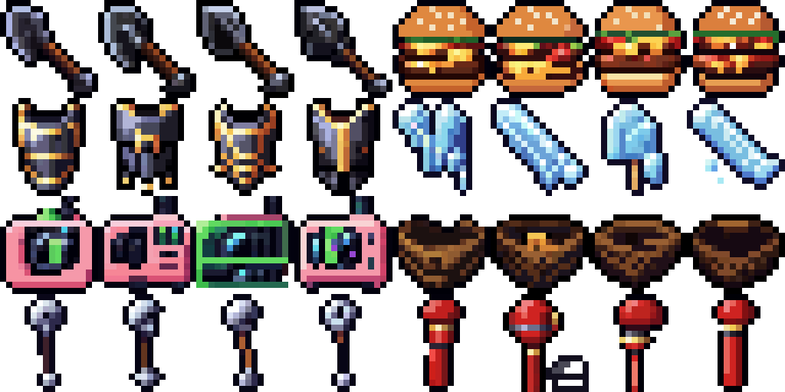
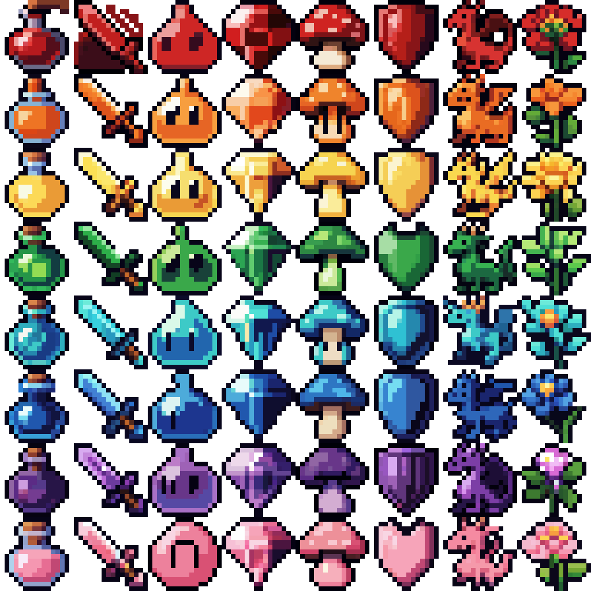
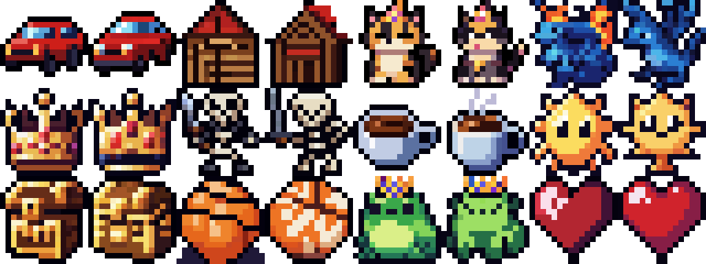

# UbaNova-16

[](https://doi.org/10.5281/zenodo.24214385)

**Text to 16×16 pixel-art game sprites.** UbaNova-16 is a small (42.4M-parameter) autoregressive transformer that draws a sprite one pixel at a time from an English prompt. Every pixel is an exact palette color and the background is truly transparent, so the output is clean pixel art with no blur and no post-processing.

Created by **Muhammad Fahril Irkham** ([@UbaNova](https://x.com/UbaNova)) · [GitHub](https://github.com/irhamuba) · [Hugging Face](https://huggingface.co/ubanova)

📄 **Paper:** [doi:10.5281/zenodo.24214385](https://doi.org/10.5281/zenodo.24214385) (Zenodo)



*Four samples each for "polished bladed mace", "tiny double cheeseburger", "legendary iron hauberk with gold trim", "ice pop with frost crystals", "futuristic pink digital camera with a green screen", "eagle nest", "silver magic staff", "red microphone with a brass trim".*

## Quick start

```bash
git clone https://github.com/irhamuba/ubanova-16.git
cd ubanova-16
pip install -r requirements.txt     # Python 3.9+; CPU-only torch: pip install torch --index-url https://download.pytorch.org/whl/cpu

python generate.py "red potion" "iron sword" --n 4 --out sprites.png
```

The weights (`model.pt`, 85 MB, and `palette.npy`) are downloaded from [Hugging Face](https://huggingface.co/ubanova/UbaNova-16) on first use. To use local files, put them in `weights/` or pass `--model` and `--palette`.

**CPU and GPU.** The device is chosen automatically: an NVIDIA GPU (CUDA) if one is available, otherwise the CPU. Force one with `--device cpu` or `--device cuda`. On GPU the model runs in FP16 autocast; on CPU in FP32.

Tested with Python 3.12, torch 2.15.0, transformers 5.22.2, huggingface_hub 2.4.0, numpy 2.5.4 and pillow 13.0.0 (CPU), and on an NVIDIA T4 (Kaggle).

Useful options:

| Option | Default | Meaning |
|---|---|---|
| `--n` | 4 | sprites per prompt |
| `--cfg` | 3.0 | classifier-free guidance; how closely to follow the prompt |
| `--temperature` | 1.0 | sampling temperature |
| `--top-p` | 0.9 | nucleus sampling; removes stray off-palette specks (1.0 disables it) |
| `--seed` | none | fixed seed for reproducible output |
| `--scale` | 8 | nearest-neighbor upscale of the saved PNG |
| `--device` | auto | `cuda` or `cpu` |

The defaults are the best setting from our evaluation. Lower temperatures make shading flat; higher guidance crops objects at the canvas border.

### Python

```python
from infer import SpriteGenerator

gen = SpriteGenerator()                 # cuda if available, else cpu
images = gen.generate("golden crown with rubies", n=4, seed=42)   # list of 16x16 RGBA PIL images
gen.create_grid(images, scale=8).save("crowns.png")
```

### Web UI

```bash
bash web/start.sh          # http://127.0.0.1:7860
```

A small local web page with a prompt box, guidance and temperature sliders, and a download button.

Speed: about 0.05 s per sprite on an NVIDIA T4 in batches (key-value caching), about 1.7 s for a request of 4 sprites, and roughly 6 s per sprite on a 4-thread laptop CPU.

## How it works

- A caption is encoded by the frozen text encoder of `openai/clip-vit-base-patch32` (32 token states).
- The model sees `[text states | BOS | pixel 1 … pixel 256]` and predicts each pixel from the ones before it, in raster order.
- Each pixel is one of 4,097 classes: 4,096 palette colors plus transparent.
- Classifier-free guidance (10% caption dropout during training) and nucleus sampling are used at inference.

| | |
|---|---|
| Architecture | decoder-only transformer, pre-LayerNorm |
| Width / layers / heads | 512 / 12 / 8 |
| Trainable parameters | 42.44M (CLIP text encoder frozen, not counted) |
| Sequence | 32 text + BOS + 256 pixels = 289 |
| Training data | [Angais/pixel-art-atlas-1.4m](https://huggingface.co/datasets/Angais/pixel-art-atlas-1.4m), 1.41M sprites |
| Training | 3 epochs, 32,934 steps, batch 128, AdamW, lr 3e-4 cosine, FP16, one NVIDIA T4 (~8 h) |
| Weights | FP16, 85 MB |

## Evaluation

On 256 held-out captions, scored with CLIP ViT-B/32 (sprites rendered on gray, upscaled to 224 px):

| Sampler | CLIP score | Caption retrieval R@1 | Colors / sprite | Stray pixels / 1000 |
|---|---|---|---|---|
| Real sprites (reference) | 25.68 | 24.2% | 23.6 | 0.57 |
| guidance 3, temperature 1.0 | 25.02 | 16.4% | 33.6 | 0.70 |
| **guidance 3, temperature 1.0, top-p 0.9 (default)** | **25.74** | **21.5%** | **22.8** | **0.50** |

- Held-out loss 1.091 nats/pixel vs 1.059 on training data, so the model does not overfit.
- None of 256 generated sprites copies a training sprite; generated sprites are at least as far from the training set as real held-out sprites.
- Color words are followed well: red, orange, green, cyan, blue and purple each reach 87–97% on "{color} {object}" prompts.



*Rows: red, orange, yellow, green, cyan, blue, purple, pink. Columns: potion, sword, slime, gem, mushroom, shield, dragon, flower.*

Known limitations:
- Relations between objects are often ignored ("a cat wearing a wizard hat" gives a cat with a crown).
- Thin diagonal objects and effects (whips, fire) can come out messy.
- Output is 16×16 only.



*Free-form prompts, two samples each: a red car; a wooden house with a red roof; a cat wearing a wizard hat; a blue dragon breathing fire; a golden crown with three rubies; a skeleton holding a sword; a cup of coffee; a smiling sun; a treasure chest full of gold coins; an orange basketball; a green frog with a crown; a pixel heart.*

## Repository layout

| Path | What |
|---|---|
| `infer.py` | model definition, KV-cached sampler, `SpriteGenerator` |
| `generate.py` | command-line generator |
| `web/` | local web UI (`server.py`, `index.html`, `app.js`, `style.css`) |
| `train.py` | data preparation, shared helpers and the TPU (PyTorch/XLA) trainer |
| `train_gpu.py` | resumable single-GPU trainer used for the released model |
| `eval/` | evaluation scripts (likelihood, CLIP alignment, memorization, sampling sweep); written as Kaggle GPU scripts |

Train from scratch on one GPU:

```bash
PIXEL_DIR=out EPOCHS=3 python train_gpu.py
```

## Data and license notes

- **Code and weights:** Apache License 2.0 (see `LICENSE` and `NOTICE`).
- **Training data:** Pixel Art Atlas is released under CC0-1.0, but its images were generated with Krea 2. Krea's Community License says users own their outputs and does not forbid training on them; commercial use of Krea outputs is allowed for organizations with under US$1M annual revenue. Check the [Krea 2 license](https://www.krea.ai/krea-2-licensing) yourself before selling generated sprites (for example as NFTs).
- Some platforms require you to disclose that images are AI-generated.
- Do not use the model to imitate characters or brands you do not own.

## Attribution

If you use UbaNova-16 or build on it, please credit:

> **UbaNova-16 by Muhammad Fahril Irkham (@UbaNova)** — https://github.com/irhamuba · https://huggingface.co/ubanova

and keep the `NOTICE` file when redistributing.

```bibtex
@misc{irkham2026ubanova,
  author       = {Muhammad Fahril Irkham},
  title        = {UbaNova: A Compact Autoregressive Transformer for Text-to-Sprite Generation at 16x16},
  year         = {2026},
  publisher    = {Zenodo},
  doi          = {10.5281/zenodo.24214385},
  url          = {https://doi.org/10.5281/zenodo.24214385},
  note         = {Code: \url{https://github.com/irhamuba/ubanova-16}, weights: \url{https://huggingface.co/ubanova/UbaNova-16}}
}
```

## Support the project

If UbaNova is useful to you, donations help pay for GPU time for the next models (32×32 and 64×64).

| Network | Address |
|---|---|
| EVM (Ethereum, BNB Chain, Polygon, Base, Arbitrum, …) | `0x3e888de8c66d2efc9456d730c566563e04ed63e0` |
| Solana | `9kSnpiHjrrFMrg8PQXAytDYwtjDcDNzc1xDnDq3AxkWY` |
| Tron (TRX / TRC-20) | `TLvdtLrzknmP4Xjkc59w8UwzGERBDS5ByW` |
| Bitcoin (Taproot) | `bc1p7hhnfzamcp58n093jfd5ncxz55mejruscwjsclqe5esd86ptxx9q35mqdm` |
| Sui | `0xa5c680ee5ef209134979eeac30cc192fb5e3cf40cb40483fbca50c229b07d085` |

Please double-check the network before sending; funds sent on the wrong network cannot be recovered.

## Links

- X: [@UbaNova](https://x.com/UbaNova)
- GitHub: [irhamuba](https://github.com/irhamuba)
- Hugging Face: [ubanova](https://huggingface.co/ubanova)
- Paper: [Zenodo, doi:10.5281/zenodo.24214385](https://doi.org/10.5281/zenodo.24214385)
